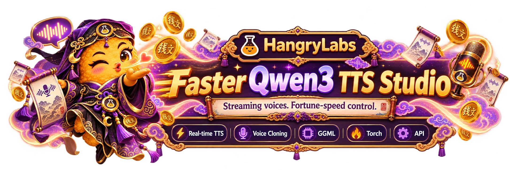
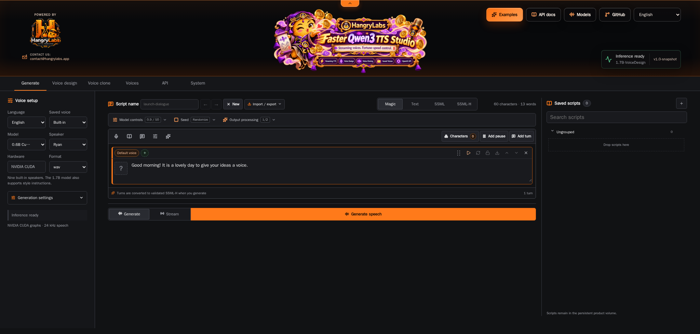

<p align="center">
  
</p>

<p align="center"><strong>English</strong> · <a href="README.nb.md">Norsk bokmål</a> · <a href="README.pl.md">Polski</a> · <a href="README.ja.md">日本語</a> · <a href="README.zh.md">简体中文</a> · <a href="README.es.md">Español</a></p>

# Hangry Labs Faster Qwen3-TTS Studio

Development version **v1.0-snapshot**. See the [version history](#version-history).

Local Qwen3-TTS voice design, voice cloning and speech generation in a Docker
Studio with a browser UI, streaming playback, HTTP APIs and a live WebSocket API.

Describe a new voice, turn it into a cloning reference, or generate speech with
one of Qwen's built-in speakers. This Hangry Labs fork brings those workflows
together with audio editing, saved voices and NVIDIA GPU controls.

**Listen first:** open the [example gallery](http://localhost:7860/examples/) in
your running Studio, with ten designed voices across ten languages, shared-voice
cloning comparisons and downloadable voice recipes. See [the gallery guide](examples/README.md)
for a static preview and regeneration commands.

## Quick Start

With Docker, NVIDIA GPU support and a CUDA 12.8-compatible driver installed, run:

```bash
docker run -d --name faster-qwen3-tts-studio --restart unless-stopped -p 127.0.0.1:7860:7860 --gpus all -e CUDA_VISIBLE_DEVICES=0 -v faster_qwen3_tts_studio_data:/app/persistent hangrylabs/faster-qwen3-tts-studio:latest
```

Open **[http://localhost:7860](http://localhost:7860)** and start generating speech.
The full image includes all five pinned checkpoints and can run offline after
the image pull. The named volume preserves models, saved voices and scripts.

<details>
<summary><strong>Smaller download: tiny image</strong></summary>

```bash
docker run -d --name faster-qwen3-tts-studio --restart unless-stopped -p 127.0.0.1:7860:7860 --gpus all -e CUDA_VISIBLE_DEVICES=0 -v faster_qwen3_tts_studio_data:/app/persistent hangrylabs/faster-qwen3-tts-studio:latest_tiny
```

Tiny downloads models into the same persistent volume on first use. Keep it
online until the selected models are cached. Choose either full or tiny.

</details>

No Git checkout, host Python or manual model setup is needed. The same port
serves the [API view](http://localhost:7860/docs) and [OpenAPI schema](http://localhost:7860/openapi.json).
See [building from source](docs/DEVELOPMENT.md#build-from-source) for development.

## What You Get

- Description-based voice design with the 1.7B VoiceDesign model
- Reference cloning with 0.6B or 1.7B Base, including optional delivery direction
- Nine built-in CustomVoice speakers, with style instructions on the 1.7B model
- Ten languages plus automatic language selection
- An offline audio example gallery with voice descriptions, reference transcripts and JSON recipes
- Complete WAV output or incremental browser playback
- Live text input with simultaneous PCM audio output through a native WebSocket API (1.7B Base)
- OpenAI-compatible speech in MP3, WAV, FLAC, Opus, AAC, Ogg and PCM
- Magic dialogue editing, a bounded SSML subset and SSML-H designed characters
- Saved script folders, locked/reusable takes and explicit workspace snapshots
- Reference upload, drag and drop, microphone selection and recording
- Waveform playback, trimming, download and browser-supported sharing
- A searchable saved-voice library with portraits, tags and restorable creation
  settings, original/processed references and confirmed voice replacement
- Optional reference transcription through an existing ASR service
- FIFO generation progress, cancellation, timing diagnostics and bounded prompt reuse
- Per-workflow default models, configurable GPU residency and GPU telemetry in System
- Python 3.13, Torch 2.10.0 and CUDA 12.8 wheels in the development image

The product targets **NVIDIA GPUs with the Torch backend** and serializes inference.
System lets you choose each workflow's default model and whether it stays loaded.
Disable **Keep selected weights in GPU memory** to release all weights after each
complete request. Explicit model choices override defaults. Pinned models stay
loaded together when VRAM permits; loading failures are visible in System.

## Browser UI

<p align="center">
  <a href="assets/screenshots/generate-ui.webp">
    
  </a>
</p>

Choose English, Norwegian Bokmål, Polish, Japanese, Simplified Chinese or Spanish
in the interface language picker. Switching preserves unsaved text, reference
recordings, takes and generated audio. The browser remembers the choice; direct
routes are `/en`, `/nb`, `/pl`, `/ja`, `/zh` and `/es`. English is the default.

Interface language and speech language are independent. Norwegian and Polish
are interface languages only. Examples follow the selected synthesis language;
Auto uses English sample text. Protocol names and model IDs remain unchanged.

| View | What you can do |
| --- | --- |
| Generate | Choose a built-in speaker, enter text and generate speech. Use 1.7B for style instructions. |
| Voice design | Describe a voice, generate a sample, then reuse or save it as a cloning reference. |
| Voice clone | Upload, record or choose a saved voice; supply its transcript and optional delivery direction. |
| Voices | Search saved references, edit portraits and metadata, use voices and restore their creation settings for refinement. |
| API | Inspect capabilities, request formats and available routes. |
| System | Load or unload models, configure reference transcription and inspect GPU activity. |

Cloning defaults to **speaker and reference transcript**. Enter the exact words
or use the explicit Transcribe reference action. Speaker-identity-only cloning
is also available when no transcript exists.

Base delivery direction is experimental and can vary by voice and instruction.
Transcript-assisted cloning is recommended; identity-only cloning may ignore
direction. CustomVoice 0.6B does not accept style instructions.

The UI includes sampling controls, exact chunk size, seed, maximum audio length,
and independent text-input and playback-streaming choices. See the
[Studio guide](docs/STUDIO.md) for workflow details and timing definitions.

## Models And Languages

| Model family | Sizes | Purpose |
| --- | --- | --- |
| Base | 0.6B, 1.7B | Clone a reference voice; optional experimental delivery direction |
| CustomVoice | 0.6B, 1.7B | Generate with nine built-in speakers; instructions on 1.7B |
| VoiceDesign | 1.7B | Create a voice from a natural-language description |

**Languages:** Chinese, English, Japanese, Korean, German, French, Russian,
Portuguese, Spanish and Italian, plus Auto.

The Studio uses five fixed official Qwen checkpoint revisions. Faster inference
comes from the engine's CUDA graph execution and caching, using the same model
checkpoints. See the [model revisions and licenses](docs/LICENSING.md).

## Docker Reference

<details>
<summary><strong>Image tags, persistence and GPU settings</strong></summary>

### Image And GPU Selection

Published images are available from [Docker Hub](https://hub.docker.com/r/hangrylabs/faster-qwen3-tts-studio/tags)
and `ghcr.io/hangry-labs/faster-qwen3-tts-studio`:

| Variant | Rolling tag | Stable tag | Models |
| --- | --- | --- | --- |
| Full | `latest` | `vX.Y` or `vX.Y.Z` | All five pinned checkpoints included |
| Tiny | `latest_tiny` | Matching version plus `_tiny` | Download into the volume on first use |

Rolling tags follow `main`; stable version tags are created for releases.
Full seeds its baked files into the same model cache used by tiny and defaults
to offline operation. See [container builds and releases](docs/RELEASING.md) and
the prepared [Docker Hub description](docs/dockerhub.md).

Change `CUDA_VISIBLE_DEVICES=0` to another physical GPU index when needed. Allow
headroom for other GPU workloads; memory needs depend on the selected checkpoint
and request. System can unload all TTS weights without stopping the UI.

The default port mapping binds to this computer only. The Studio has no account
system. An optional `QWEN_STUDIO_API_KEY` protects `/v1` and enabled MCP endpoints. Publish the
whole Studio to a trusted network only with appropriate
access controls. Browser microphone capture needs localhost or HTTPS and
permission.

### Persistent Data And Settings

Mount one volume at `/app/persistent` and reuse it when replacing the container.

| Location | Contents |
| --- | --- |
| `/app/persistent/huggingface` | Downloaded model checkpoints |
| `/app/persistent/torch_inductor` | Compiler cache |
| `/app/persistent/studio` | Settings, explicitly saved voices, scripts and workspace audio |

| Environment variable | Default | Purpose |
| --- | --- | --- |
| `CUDA_VISIBLE_DEVICES` | Set to `0` in the quick start | Select the visible NVIDIA GPU |
| `QWEN_STUDIO_ASR_URL` | Empty | Initial connection to an existing reference-transcription service |
| `QWEN_STUDIO_QUEUE_SIZE` | `8` | Maximum waiting inference requests; excess requests receive HTTP 429 |
| `QWEN_STUDIO_API_KEY` | Empty | Optional Bearer key for OpenAI-compatible `/v1` routes only |
| `QWEN_STUDIO_DATA` | `/app/persistent/studio` | Operator settings and saved-voice directory |
| `HF_HOME` | `/app/persistent/huggingface` | Model download cache |
| `TORCHINDUCTOR_CACHE_DIR` | `/app/persistent/torch_inductor` | Compiler cache |

Configure ASR in **System > Reference transcription**. Saved settings take
precedence over the environment default. The Studio does not run a local ASR
model; generation and manual transcripts work without a transcription service.

Uploaded references are temporary unless explicitly saved. Prepared clone
prompts are cached by content in system RAM, bounded to eight entries and 8 MiB
of tensor data, and cleared on model unload. Browser prompts and generated
outputs are not automatically saved across page reloads.

### Stop Or Replace The Container

```bash
docker stop faster-qwen3-tts-studio
docker start faster-qwen3-tts-studio
```

To use a rebuilt image, stop and remove the container, then rerun the quick-start
`docker run` command with the same named volume. Removing the volume deletes
cached models, settings and saved voices.

</details>

## API Usage

<details>
<summary><strong>OpenAI-compatible and native HTTP API examples</strong></summary>

Discover models and controls with `GET /studio/capabilities`. Generation accepts
multipart form data with an `options` JSON field and, for cloning, a `reference`
audio upload or saved `voice_id`.

```bash
curl http://localhost:7860/studio/capabilities
```

With `httpx` installed in your client environment, this Python example requests
a built-in voice and saves the returned WAV:

```python
import base64
import json
from pathlib import Path

import httpx

options = {
    "mode": "custom",
    "model": "Qwen/Qwen3-TTS-12Hz-0.6B-CustomVoice",
    "text": "Good morning from Hangry Labs.",
    "speaker": "Ryan",
    "language": "English",
}
response = httpx.post(
    "http://localhost:7860/studio/generate",
    data={"options": json.dumps(options)},
    timeout=300,
)
response.raise_for_status()
Path("speech.wav").write_bytes(base64.b64decode(response.json()["audio_b64"]))
```

The complete response contains `audio_b64`, `sample_rate` and `metrics`.
`POST /studio/generate/stream` returns server-sent events with progress and
base64 WAV chunks. It is not a raw audio byte stream. Use `?streaming=false`
for queue/loading progress around a complete generation.

| Route | Purpose |
| --- | --- |
| `GET /studio/status` | Readiness, active model and queue state |
| `GET /studio/capabilities` | Models, speakers, languages, controls and limits |
| `POST /studio/generate` | Complete generation as JSON with base64 WAV |
| `POST /studio/generate/stream` | Generation progress and WAV chunks as SSE |
| `GET /studio/voices` | Explicitly saved voice profiles |
| `POST /studio/models/load` | Load an official checkpoint |
| `POST /studio/models/unload` | Release all loaded models |

The [Studio guide](docs/STUDIO.md) covers the browser and existing multipart
contracts. The [speech API guide](docs/API.md) covers OpenAI-compatible clients,
native binary/streaming output, voice saving, Magic and script workspaces.
For arriving LLM text, use the [live speech API](docs/LIVE_API.md) at
`ws://localhost:7860/tts/live`, with 1.7B Base saved-voice ICL or speaker-only cloning.

```bash
curl http://localhost:7860/v1/audio/speech \
  -H 'Content-Type: application/json' \
  -d '{"model":"qwen3-tts","input":"Good morning from Hangry Labs.","voice":"Ryan","response_format":"mp3"}' \
  --output speech.mp3
```

For structured dialogue, opt in with `input_type="ssml"` or `"ssml-h"` on native
routes. Read the exact [SSML-H processor profile](docs/SSML-H.md); this is a
bounded subset, not complete W3C SSML support. OpenAI input stays plain text.

</details>

## Local Development

<details>
<summary><strong>Docker-first development and testing commands</strong></summary>

Install Task v3, PowerShell 7 and uv alongside Docker. Heavy runtime dependencies
stay in the container.

```powershell
task init
task start
task stop
task package
```

`task start` mounts local source read-only; `task start DEV_MOUNT=0` uses only the
packaged image. `task validate` checks syntax, lifecycle safety and notices;
`task test-runtime` runs CPU unit tests in Docker. `task smoke` exercises real
generation against an explicitly configured ASR service.
With Node.js 22 or newer installed, `task test-ui` checks input-mode isolation
and audio replacement races without loading a model.

`task package` prepares Python artifacts. `task release DRY_RUN=1` previews
snapshot promotion; a real `task release` creates local release/next-snapshot
commits and an annotated tag. It does not push or publish. `task nuke` deletes
this project's container, local image and **all data in its volume**. Python
runtime dependencies are pinned with wheel hashes; apt packages remain separate
moving inputs. See [development tasks](docs/DEVELOPMENT.md).

</details>

## Benchmarks And Engine Reference

<details>
<summary><strong>Measured baselines, benchmark commands and engine reference</strong></summary>

The [manual benchmark suite](benchmarks/README.md) follows VoxCPMTTS's speed,
GPU-memory, transcript-quality, queue and SSML methodology, with separate
Qwen checkpoints and streaming latency measurements. Start with
`task benchmark-build`, `task benchmark-preflight` and `task benchmark-plan`;
these do not run GPU inference. Controlled runs require an isolated GPU and the
existing remote ASR service. Reviewed [0.6B](benchmarks/BASELINE_RESULTS.md) and
[1.7B](benchmarks/BASELINE_1.7B_RESULTS.md) baselines cover 310 and 510 measured
requests across ten languages, with one checkpoint loaded at a time. Use
`task benchmark-full` for the Faster-only product run, including
streaming first-audio latency, per-model VRAM, SSML and FIFO reliability.

The [inherited tables](docs/UPSTREAM_BENCHMARKS.md) are upstream results and should
not be presented as measurements of this Docker build.

[Engine and Python reference](docs/ENGINE.md) covers the inherited library/CLI,
streaming, clone conditioning and parity tests. These details are secondary to
the maintained Docker Studio workflow.

</details>

## Upstream Project And This Fork

[Faster Qwen3-TTS](https://github.com/andimarafioti/faster-qwen3-tts) by Andres
Marafioti provides the accelerated inference engine. The
[Qwen team](https://github.com/QwenLM/Qwen3-TTS) provides the model family and
core research. We maintain its inference implementation locally, including the
Transformers 5 fixes from
[andimarafioti/Qwen3-TTS](https://github.com/andimarafioti/Qwen3-TTS/tree/distribution/qwen-tts-hf).
These are our three ongoing upstreams; [source provenance](docs/UPSTREAMS.md)
records exact revisions, package boundaries and the update procedure. Both the
model and accelerated engine ship from this checkout, without an external Qwen
inference package or Gradio demo. Streaming adaptations also draw from
[Qwen3-TTS-streaming](https://github.com/dffdeeq/Qwen3-TTS-streaming), with CUDA
graph inspiration acknowledged from
[nano-qwen3tts-vllm](https://github.com/tsdocode/nano-qwen3tts-vllm).

Hangry Labs maintains this fork's Docker workflow, standalone Studio, audio
tools, saved voices, service integration and validation. The UI builds on the
Hangry Labs [VoxCPMTTS](https://github.com/hangry-labs/VoxCPMTTS) shell. Upstream
model authors retain credit for their weights and research.

## Support And Issues

Report bugs and feature requests in
[this repository's issue tracker](https://github.com/hangry-labs/faster-qwen3-tts-studio/issues).
Include reproduction steps, container logs, GPU/driver information and the model
and settings involved. Remove tokens, private recordings and personal information
before sharing logs.

## Version History

<details>
<summary><strong>v1.0-snapshot development notes</strong></summary>

### v1.0-snapshot

The first Hangry Labs Studio development version. Python distributions use the
PEP 440 version `1.0.dev0`. This snapshot name does not create a stable release
or change the rolling Docker image tags.

- Fix stereo waveform/sample-rate tuple inputs in the local Qwen Python cloning
  interface while preserving mono inputs and the original sample rate.
- Add a bounded text-in/audio-out WebSocket API for saved-voice cloning, including
  reference transcripts, continuous inference, queue sharing and disconnect cleanup.
  Restrict live text input to 1.7B Base for consistent delivery.
- Add an offline listening gallery with native-language designed references,
  ten-language speech samples, cross-language cloning and a three-character
  SSML-H scene. Include editable JSON definitions and downloadable recipes.
  Encode listening clips as 64 kbps VBR Opus while keeping lossless cloning references.
- Add OpenAI-compatible saved voice creation/deletion and local consent resources,
  including prompt-based Qwen voice design, over the shared Studio voice library.
- Expose bounded streaming decoder context in all three voice modes, the UI and
  speech APIs; retain the 25-frame default and add a paired 25/100-frame benchmark.
- Simplify full/tiny Docker Quick Starts to one command, move source builds into
  the development guide and add the Studio screenshot to all README languages.
- Add six complete interface locales and translated README introductions. Switch
  interface language without reloading or discarding browser work; retain English
  fallback and translate Qwen model controls, voice dialogs, MCP and diagnostics.
  Keep synthesis language independent and provide examples for all ten speech languages.
- Bound inference admission with explicit HTTP 429 overload responses, FIFO
  cancellation and queue telemetry; keep single-request GPU inference.
- Overlap CPU speech-unit effects and finishing with queued GPU inference.
  Compile native/OpenAI requests off the HTTP event loop, bound unfinished
  synthesis requests and expose preparation, GPU-lease and CPU-tail timings.
  [Matched concurrent measurements](benchmarks/inference_queue/PROCESSING.md)
  record the plain control and the effects/normalization workload separately.
  [Sustained load measurements](benchmarks/inference_queue/SUSTAINED.md) keep
  four/eight clients busy continuously and report actual occupancy and queue depth.
- Add independently enabled compact/advanced MCP, expiring audio links, bounded
  reference locations and persistent voice tools. Expose build identity and lock
  transitive Python wheels; add tested snapshot/release preparation with a real
  transformation dry run and separate publication.
- Add searchable voice cards, editable metadata and normalized portraits. Preserve
  source/original/processed audio with creation recipes; restore voices for
  refinement and confirm fresh-audio replacements. Extend Magic character saving
  with metadata, portraits and explicit name-collision handling.
- Plan protected long text around sentence/clause boundaries and word/CJK budgets.
  Report token/context cutoffs; complete native generation can retry smaller
  sections before delivering audio.
- Stream audio within dialogue units, compact internal padding with bounded
  buffering and normalize the joined stream once. Reduce compressed-encoder
  startup buffering while retaining the same recording for replay.
- Add Signalsmith shaping, advanced mastering controls and native-rate float WAV
  previews while preserving original audio and optional normalization.
- Record the 1.7B baseline: 510 measured requests across CustomVoice, Base and
  VoiceDesign, one model loaded at a time. Complete-response realtime speeds
  were 2.88x, 2.94x and 2.86x respectively on the test workstation. Retain
  transcript outliers alongside the latency, memory, directed SSML-H and FIFO
  results; the 0.6B history remains available.
- Label benchmark throughput as Realtime speed and lead speed tables with that
  multiplier. Define 3.3x as 3.3 seconds of generated audio per second; retain
  RTF and streaming latency as separate measurements.
- Record the first isolated 0.6B product baseline: 310 measured Faster Qwen
  requests across ten languages, complete and streaming speech, ten complete
  SSML dialogues and 20 identical FIFO output pairs. Preserve per-model memory,
  startup/teardown and transcript-fidelity results in the benchmark reports.
- Add `task benchmark-full` for a Faster Qwen product baseline: complete speech,
  streaming, SSML and FIFO tests with one checkpoint resident at a time. Keep
  model load/unload timings separate, verify zero loading in warmed calls,
  record Torch peak memory and streaming chunk arrivals, and judge recordings
  remotely after every TTS measurement has finished. Standard-engine comparisons
  are optional diagnostics and are excluded from the product run.
- Add persisted per-workflow model defaults and GPU residency controls in System.
  Keep 0.6B Base and CustomVoice plus 1.7B VoiceDesign ready by default. Request-only
  weights release after the complete request; pinned models can coexist. Expose
  per-model loading failures without silently evicting other pinned weights.
- Release captured CUDA graphs and cached BLAS workspaces on full unload,
  returning GPU allocator memory instead of leaving reserved multi-gigabyte pools.
- Default baseline and streaming benchmarks to warmed, resident 0.6B checkpoints;
  keep explicit 1.7B design and directed-SSML coverage separate.
- Complete the first shared-GPU smoke: all five suites and 40 measured requests
  passed, including ten-turn SSML completion and four-client FIFO WAV identity.
  Retain the results as preliminary evidence, separate from official history.

- Add the manual benchmark suite: isolated native/faster workers,
  five pinned checkpoints, multilingual speed/memory/ASR fidelity reports,
  streaming first-audio measurements, queue identity checks and paired ten-turn
  SSML reliability. Planning and offline tests can run without GPU inference;
  native-engine comparisons remain optional diagnostics.

- Maintain Qwen inference, compatibility changes and accelerated generation
  locally under `src/`, with provenance for all three upstream sources.
- Package the Studio for NVIDIA GPUs with Python 3.13 and local model caches.
- Provide voice design, saved-voice cloning with experimental delivery direction,
  built-in speakers, OpenAI-compatible speech and native speech APIs.
- Support Text, standard SSML, SSML-H and the Magic dialogue editor, including
  per-turn takes, retained takes, designed characters and saved workspaces.
- Isolate Text and SSML drafts when switching input modes. Import edited SSML-H
  into Magic only after validation, preserving the active draft on errors.
- Add a compact Generate layout, generation menus, joined
  Generate/Stream control, progress display, waveform players and finishing UI.
- Assemble completed Magic takes automatically after turn edits. Save settings,
  original output and processed previews with dialogue workspaces.
- Track progress per request. Preview MP3 streams progressively and retain the
  same recording for replay, download and finishing. Stream mode uses MP3;
  Generate mode uses the selected output format.
- Add bounded FFmpeg noise cleanup, EQ, compression, loudness normalization and
  optional pitch/speed shaping, with separate original and processed previews.
- Protect audio replacement from stale loads clearing newer recordings.

Native speaker direction requires the 1.7B CustomVoice model. Base delivery
direction remains experimental. Finishing uses FFmpeg and optional Signalsmith
shaping; generation does not expose diffusion controls. Word timing
and subtitle export are not available. See [API capabilities](docs/API.md) for the
supported input semantics and limits.

</details>

## Responsible Use And Privacy

Only clone speakers with the necessary consent and recording rights. Do not use
synthetic voices for deceptive impersonation, fraud or harassment. Check generated
speech before publication, including commercial use.

Generation runs locally. First-use model downloads contact the model host.
Reference transcription sends audio to the configured ASR service only when
explicitly requested. Saved voices retain reference recordings in the product
volume; do not share that volume or recordings without authorization.

## License

The original wrapper retains its MIT license; adapted Qwen/streaming portions
retain Apache-2.0 obligations. The Python distribution is described as
`MIT AND Apache-2.0`. Model weights and Docker dependencies retain their own
licenses; the complete runtime is not covered by a single MIT grant.

Read [LICENSE](LICENSE), [NOTICE](NOTICE),
[Third-Party Notices](THIRD_PARTY_NOTICES.md) and the
[licensing guide](docs/LICENSING.md) for model redistribution, commercial-use
findings and component distribution requirements.
